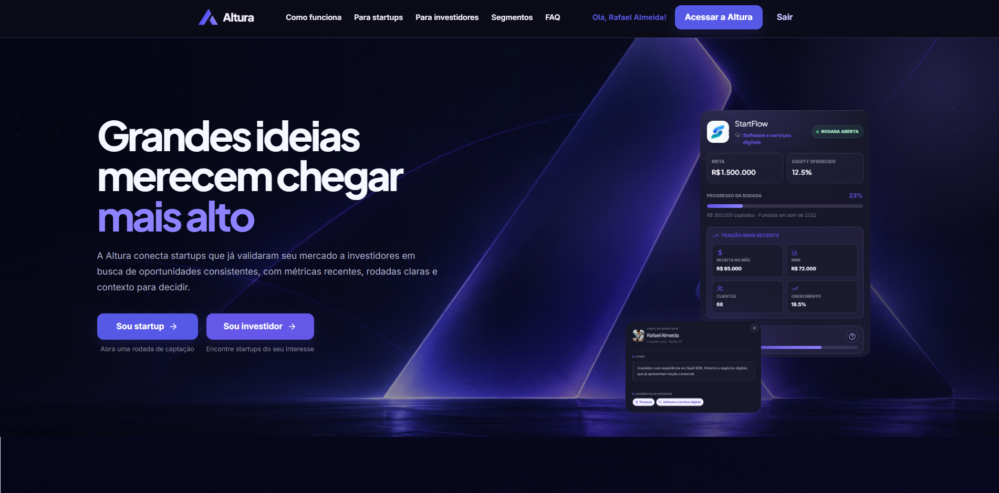
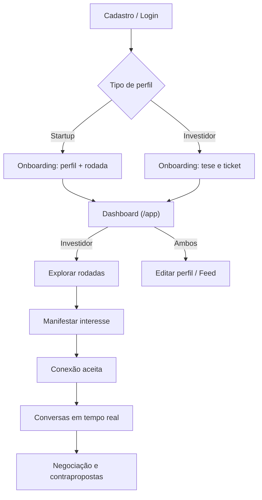

<p align="center">
  
</p>

<p align="center">
  
</p>

<h1 align="center">ALTURA</h1>

<p align="center">
  <strong>Plataforma de matchmaking entre Startups e Investidores</strong><br>
  <em>Projeto Integrador 2026.2 • UE: FullStack • Senac</em>
</p>

<p align="center">
  
  
  
  
  
</p>

---

## 💡 Visão Geral

A **ALTURA** conecta **startups com tração em busca de captação** a **investidores com teses alinhadas**. Com perfis estruturados, métricas mensais (receita, MRR, clientes, crescimento), filtros avançados e um catálogo de rodadas abertas, a plataforma reduz o tempo de busca no ecossistema de inovação.

- **Startups:** visibilidade qualificada e apresentação padronizada de tração.
- **Investidores:** *dealflow* curado, focado em startups com tração comprovada.

O frontend é uma SPA em **React 19 + TypeScript**; o **Spring Boot 3** cuida de autenticação, validações e API, com **PostgreSQL (Neon)**.

---

## ✅ Funcionalidades

- **Landing page:** hero, como funciona, trilhas por público, segmentos, FAQ e CTA.
- **Autenticação:** cadastro/login por e-mail e senha com papel (Startup ou Investidor), BCrypt, JWT curto e refresh token rotativo.
- **Onboarding:** formulário por papel validado com Zod (CNPJ/CPF, segmentos, rodada, tração ou ticket), com rascunho automático em `localStorage`.
- **Dashboard e perfil:** visão geral por papel, edição de perfil e prévia de como o perfil aparece para o outro lado.
- **Perfis públicos:** visualização detalhada de startups, métricas de tração, segmentos, rodada aberta, vídeo de pitch e manifestação de interesse.
- **Exclusão de perfil:** diálogo com confirmação em duas etapas; remove o perfil (a conta de acesso permanece) e redireciona ao onboarding.
- **Explorar rodadas (investidor):** listagem com filtros (nome, segmento, ticket, equity mínimo), cards de oportunidade e modal com detalhes e vídeo de pitch.
- **Gestão de rodada (startup):** edição dos termos da única rodada criada no cadastro, encerramento, cancelamento, reabertura, prazo e histórico de propostas.
- **Negociação de propostas:** proposta e contraproposta com histórico, aceite, recusa e cancelamento; o aceite atualiza automaticamente o valor captado.
- **Match personalizado:** pontuação calculada no backend por segmentos, faixa de investimento, tração e localização, com explicação dos fatores.
- **Indicadores reais:** os painéis usam rodadas, conexões e investimentos efetivamente registrados, sem números simulados.
- **Atualização em tempo real:** mensagens, conexões, propostas, notificações e alterações de rodada são propagadas por WebSocket.
- **Feed de tração:** publicações com categorias, métrica em destaque, imagem ou vídeo do YouTube, curtidas e comentários.
- **Conexões e matches:** investidores podem demonstrar interesse em uma rodada; startups aceitam ou recusam solicitações e ambas as partes acompanham o status da conexão.
- **Conversas privadas:** chat liberado após uma conexão aceita, com histórico persistido e atualização em tempo real via WebSocket.
- **Contrapropostas na conversa:** depois do aceite, startup e investidor podem negociar por mensagens as condições da rodada — como valor, participação e próximos passos — e apresentar contrapropostas diretamente no chat. O histórico da negociação permanece registrado para os dois lados.
- **Notificações:** central de notificações para novas conexões, mudanças de status, mensagens, curtidas e comentários, com contador de não lidas e ações para marcar como lidas ou limpar a lista.
- **Feed de tração:** publicações com categorias, métrica em destaque, imagem ou vídeo do YouTube, curtidas, comentários e exclusão pelo autor.
- **Acessibilidade e experiência:** navegação SPA com History API, rotas protegidas, estados de carregamento, transições de página, suporte a tema claro/escuro e link para pular ao conteúdo.

### Imagens do feed

As imagens ficam em um bucket privado do **Neon Object Storage** (o banco guarda só a chave) e são servidas por URL assinada temporária. Antes do upload, o navegador reduz a imagem para no máximo 1600 px e converte para WebP (meta ~500 KB, limite 1 MB). O backend revalida MIME, assinatura binária e tamanho.

Variáveis necessárias em `backend/.env` (nunca no frontend):

```dotenv
AWS_ENDPOINT_URL_S3=https://SEU-ENDPOINT-DE-STORAGE
AWS_REGION=us-east-2
AWS_ACCESS_KEY_ID=...
AWS_SECRET_ACCESS_KEY=...
STORAGE_BUCKET=altura-feed
STORAGE_SIGNED_URL_MINUTES=60
```

Sem elas, a API funciona para texto e YouTube, mas recusa o envio de imagens.

---

## 🔄 Fluxo Principal



---

## 🧭 Rotas

| Rota | Página | Acesso |
| :--- | :--- | :--- |
| `/` | Landing page | Público |
| `/login` | Login | Público |
| `/cadastro`, `/cadastro/startup`, `/cadastro/investidor` | Cadastro | Público |
| `/onboarding` | Onboarding de perfil | Autenticado (sem perfil) |
| `/app` | Dashboard | Autenticado |
| `/editar-perfil` | Editar perfil | Autenticado |
| `/explorar-rodadas` | Explorar rodadas | Investidor |
| `/rodadas` | Gestão e histórico de rodadas | Startup |
| `/feed` | Feed de tração | Autenticado |
| `/startups/:id` | Perfil público da startup | Autenticado |
| `/conversas` | Conexões e conversas | Autenticado |

Estados de autenticação: `loading` → `signedOut` → `needsProfile` → `ready`.

### Navegação e carregamento

A SPA usa a History API por meio do `NavigationProvider`, que é a única fonte de verdade para a rota atual. Links internos, chamadas a `navigate()`, voltar e avançar do navegador passam pelo mesmo fluxo. Durante uma troca, a tela atual permanece visível sob um indicador discreto; depois do carregamento, a nova página recebe uma transição curta, o foco vai para o conteúdo principal e a posição de rolagem é restaurada ao voltar.

- `AppLoader`: splash inicial e fallback das telas carregadas sob demanda.
- `RouteLoader`: progresso visual de navegação e requisições demoradas.
- `PageTransition`: animação por direção e gerenciamento de foco.
- `ProtectedRoute`: decisões centralizadas de acesso e redirecionamento.
- `RouteErrorBoundary`: estado de erro recuperável, sem tela em branco.

As páginas internas são separadas em chunks com `React.lazy`. O cliente HTTP registra automaticamente a atividade de rede, e a interface respeita `prefers-reduced-motion`. Navegações programáticas simultâneas são bloqueadas; eventos de voltar/avançar cancelam transições antigas para evitar condições de corrida.

Para adicionar uma tela:

1. Inclua o novo tipo de rota e sua leitura de URL em `src/navigation/routes.ts`.
2. Se for privada, acrescente o nome da página a `protectedPages` no mesmo arquivo.
3. Importe a página com `lazy()` e associe a rota em `src/App.tsx`.
4. Navegue usando um link interno normal (`<a href="/rota">`) ou `navigate('/rota')` quando a ação não for um link.
5. Mantenha estados de carregamento, erro e vazio específicos dos dados dentro da própria página; o indicador global já cobre as requisições feitas por `apiRequest`.

---

## 🛠 Stack

- **Frontend:** React 19, TypeScript, Vite 6, Tailwind CSS 4, Zod 4, lucide-react.
- **Backend:** Java 17, Spring Boot 3, Spring Security, Spring JDBC, WebSocket, JWT, BCrypt.
- **Banco:** PostgreSQL no Neon (acesso só pelo backend, via TLS).
- **Schema:** `database/altura_schema.sql`. Em banco existente, execute as migrations em ordem. Para esta etapa, aplique `database/20261017_rounds_proposals_realtime.sql` no Neon antes de reiniciar a API.

---

## 📂 Estrutura

```text
altura/
├── backend/     # API Spring Boot e repositórios JDBC
├── database/    # Schema e migrations PostgreSQL
├── docs/        # openapi.yaml
├── public/      # Assets estáticos
└── src/
    ├── auth/        # Contexto e API de autenticação
    ├── components/  # Páginas e componentes de UI
    ├── data/        # Dados e tipos
    ├── lib/         # Cliente HTTP e contratos da API
    ├── navigation/  # Rotas, History API e atividade de carregamento
    ├── utils/       # Documentos, localização, vídeos, imagens
    └── App.tsx      # Roteamento (History API)
```

---

## 📖 API

Com o backend rodando: Swagger UI em `http://localhost:8080/swagger-ui.html` e OpenAPI JSON em `http://localhost:8080/v3/api-docs`.

Principais grupos de endpoints autenticados:

- **Perfis e rodadas:** `/api/me`, `/api/me/startup-profile`, `/api/me/investor-profile`, `/api/startups/{userId}/details`, `/api/rounds/open`.
- **Feed:** `/api/feed`, `/api/feed/{postId}/like` e `/api/feed/{postId}/comments`.
- **Conexões e mensagens:** `/api/connections`, `/api/connections/{connectionId}/status` e `/api/connections/{connectionId}/messages`.
- **Notificações:** `/api/notifications`, `/api/notifications/unread-count`, marcação individual/em massa como lida e limpeza da lista.

O canal WebSocket autenticado fica disponível em `/ws` e publica eventos de novas
mensagens e remoção de conexões para manter a tela de conversas sincronizada.

---

## ⚖ LGPD

O projeto segue *Privacy by Design* (Lei nº 13.709/2018): coleta mínima de dados, controle de acesso pelo `sub` do JWT, senhas em BCrypt, refresh tokens em SHA-256 e direitos do titular via edição e exclusão de perfil.

---

## 💻 Como Executar

Pré-requisitos: Node.js 20+, npm, Java 17 e Maven 3.9+.

```bash
git clone https://github.com/kiellzz/altura.git
cd altura_p.i_2026.2
npm install

# Frontend: crie .env com VITE_API_URL=http://localhost:8080/api
# Backend: configure backend/.env a partir de backend/.env.example

cd backend && mvn spring-boot:run   # terminal 1
npm run dev                         # terminal 2 (na raiz)
```

Acesse `http://localhost:5173`. Scripts: `npm run dev`, `npm run build` (tsc + build) e `npm run preview`.

---

## 👥 Equipe

Pedro Henrique Maciel • Hugo Dantas • Roberto Alves • Cleybson Teixeira • Ezequiel Borges • Eduardo Soares

*Orientação: Prof. Geraldo Gomes*
